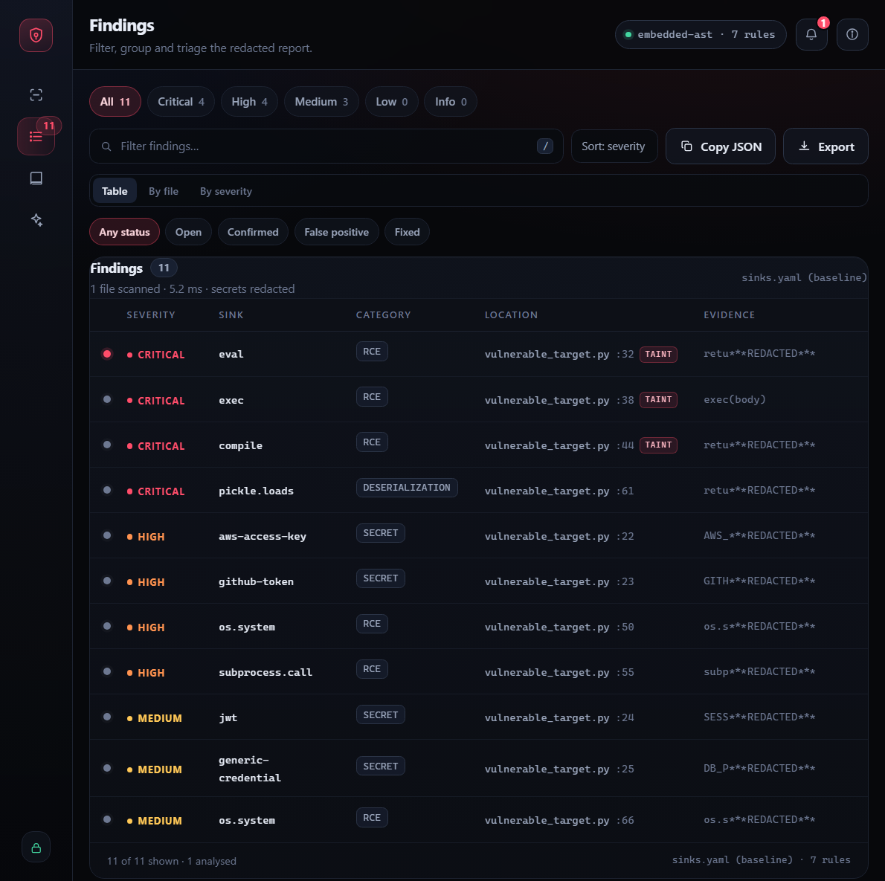
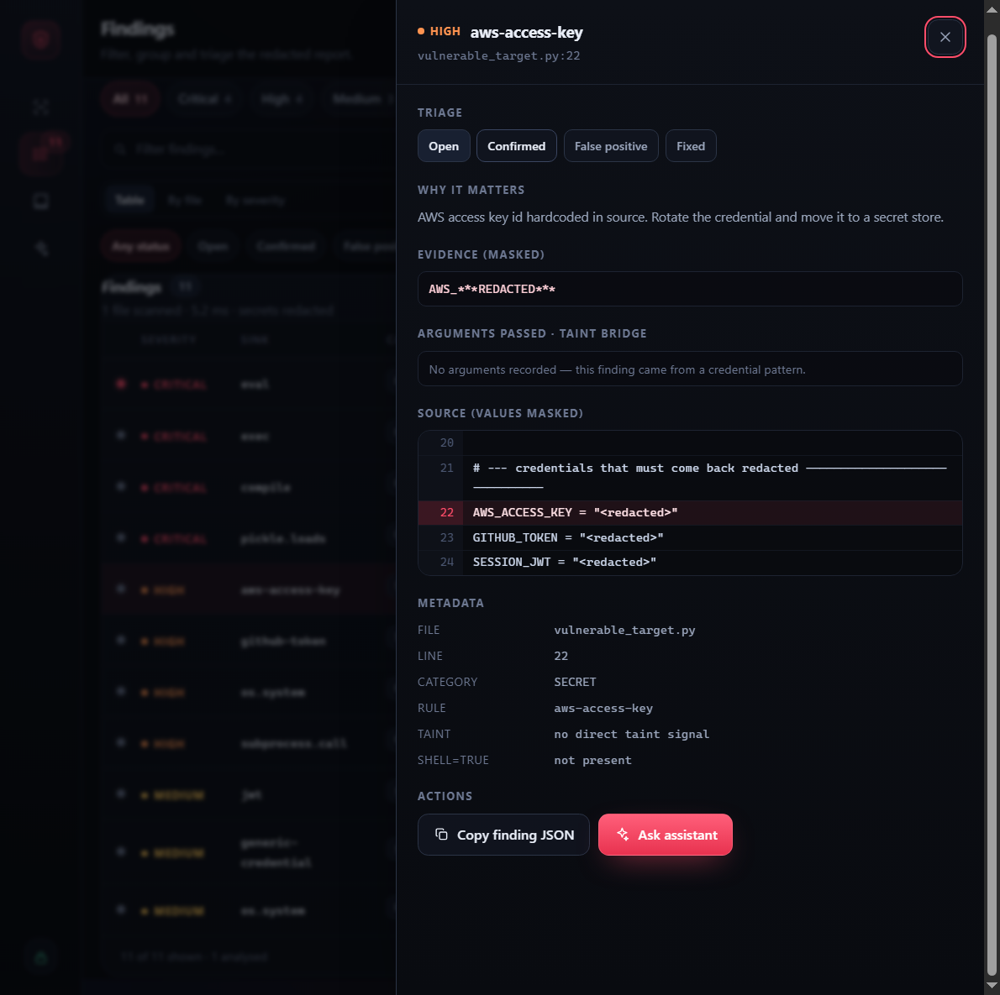
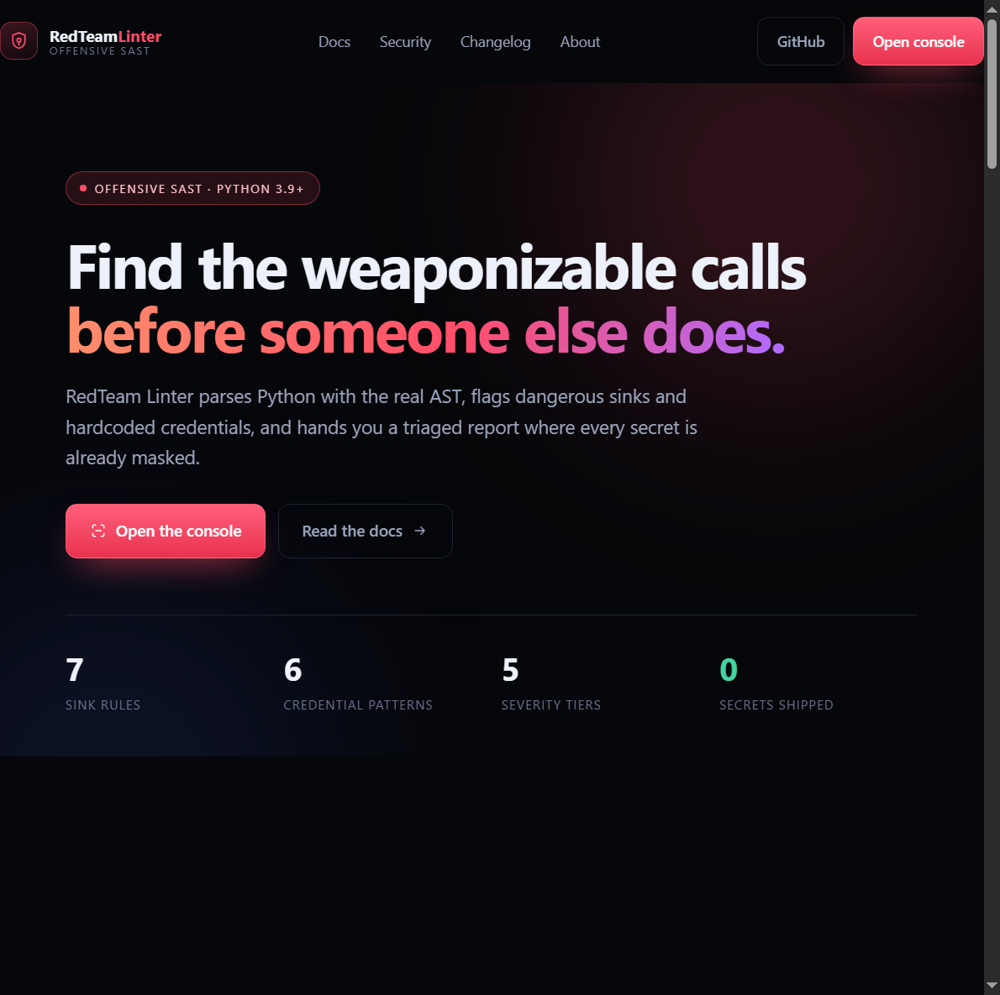

# RedTeam Linter

**Offensive-oriented static analysis for Python — AST sink detection, secret harvesting, a triaged browser console and a built-in assistant, with redaction enforced on the way out.**

RedTeam Linter parses Python with `ast`, flags calls to dangerous sinks (`eval`, `exec`, `compile`, `os.system`, `subprocess.call(shell=True)`, `pickle.loads`, …) plus hardcoded credentials, and presents them through a severity-ranked terminal report, a deterministic JSON artifact, or a public marketing site plus a four-view browser console at `/app`.

Every finding is redacted **before** it is printed, serialized or sent to the browser. Raw secrets and raw matched lines never reach your terminal, your JSON export, devtools, or the assistant.







---

## Table of contents

- [Why it exists](#why-it-exists)
- [Features](#features)
- [Architecture](#architecture)
- [Install](#install)
- [Quick start](#quick-start)
- [Console guide](#console-guide)
- [Assistant](#assistant)
- [Security model](#security-model)
- [Rule configuration (`sinks.yaml`)](#rule-configuration-sinksyaml)
- [Output & redaction](#output--redaction)
- [HTTP API](#http-api)
- [Test target & expected results](#test-target--expected-results)
- [Configuration reference](#configuration-reference)
- [Project layout](#project-layout)
- [Limitations](#limitations)

---

## Why it exists

Most Python linters check style; most SAST tools are heavy, noisy or SaaS. This is a small tool you can read end to end in an afternoon, built for the offensive/audit workflow:

1. Drop in a target file or a handful of files.
2. Get the risky call sites ranked, with the line and the argument expression that flows into the sink.
3. Triage them in a UI that needs no build step, then export a report that is safe to attach to a writeup.

Harvesting, analysis, reporting and presentation are separate layers, so any one can be replaced without touching the others.

## Features

**Detection**

- AST-based sink matching — comments, docstrings and string literals cannot produce false positives.
- Import-alias resolution: `from os import system as sh` and `import subprocess as sp` still resolve to the canonical rule name.
- `shell=True` awareness: `subprocess.call(["ls", "-l"])` is clean, `subprocess.call(cmd, shell=True)` is `HIGH`.
- Taint heuristic: arguments that trace to request/argv/input-style sources are marked `user_input_reachable` and escalated to `CRITICAL`.
- Secret patterns: AWS access key IDs, GitHub tokens, Slack tokens, PEM private keys, JWTs, bearer tokens and generic `password`/`api_key`-style assignments, with placeholder filtering.
- Syntax errors become a single `INFO` finding instead of a crash; non-Python files are reported as skipped.

**Console** (vanilla HTML/CSS/JS, no build step)

- Four views — **Scan**, **Findings**, **Rules**, **Assistant** — behind a hash router, with a skip link, a footer and a not-found view. Marketing pages (landing, docs, security, changelog, about, 404) are server-rendered HTML at their own paths.
- Cursor-following tooltips on every button and icon: a label plus a one-line description, clamped to the viewport, anchored to the control for keyboard focus, and disabled on touch devices.
- Findings table with severity chips, status chips, free-text filter, sort control, and grouping by file or by severity.
- Detail sheet: triage status, why it matters, masked evidence, `arguments_passed`, a redacted source excerpt with the flagged line highlighted, metadata, copy-finding, ask-assistant.
- Triage status per finding (Open / Confirmed / False positive / Fixed), persisted in the browser.
- Notification centre with unread badge for scans, triage changes, exports, assistant replies and failures.
- Rule inspector showing exactly what was loaded from `sinks.yaml`.
- Keyboard: <kbd>Ctrl</kbd>/<kbd>⌘</kbd>+<kbd>Enter</kbd> scan, <kbd>Alt</kbd>+<kbd>1…4</kbd> switch view, <kbd>/</kbd> filter, <kbd>t</kbd> cycle grouping, <kbd>Esc</kbd> close.
- Web essentials: SVG favicon and web manifest, Open Graph/Twitter meta, `robots.txt`, a print stylesheet, a skip link and focus-trapped dialogs.
- Responsive from wide desktop down to tablet; no horizontal page scroll.
- All rendering uses DOM APIs and `textContent` — a hostile snippet cannot become markup.

**Assistant**

- Works with **zero configuration**: a deterministic knowledge base explains sinks, severity, redaction, taint, triage and rules offline.
- Optional **LLM mode** through any OpenAI-compatible endpoint, called server-side only; the key never reaches the browser.
- The assistant receives a whitelisted, already-redacted finding — never source bytes, `matched_snippet` or `secret_value` — and falls back to the local answer if the provider fails.

## Architecture

```
samples/*.py ─┐                       ┌──► reporter.ReportGenerator ──► terminal / JSON
              ├─► webapp/engine.py ───┤        (redaction boundary)
uploads ──────┘        (AST)          └──► webapp/server.py ──► redacted payload ──► browser
                            ▲                                          │
                     sinks.yaml (config_loader)                        └──► webapp/assistant.py
                                                                              (local KB or LLM)
```

| Layer | File | Responsibility |
| --- | --- | --- |
| Rules | `sinks.yaml`, `config_loader.py` | Declarative sink table, validated, with a built-in fallback. |
| Analysis | `webapp/engine.py` | Parse, resolve aliases, match sinks, harvest secrets, build the redacted source excerpt. |
| Reporting | `reporter.py` | Single redaction enforcement point, severity ordering, terminal + JSON. |
| Presentation | `webapp/server.py`, `webapp/static/*` | FastAPI routes plus the four-view console. |
| Assistant | `webapp/assistant.py` | Local remediation knowledge base, optional OpenAI-compatible call. |
| Hardening | `webapp/security.py` | CSP and headers, origin guard, body cap, rate limiting. |

## Install

Requires **Python 3.9+**.

```bash
git clone https://github.com/HUMZAJAFFAR/redteam-linter.git
cd redteam-linter

python3 -m venv .venv
. .venv/bin/activate          # Windows: .venv\Scripts\activate
pip install -r requirements.txt
```

`rich` and `PyYAML` cover reporting and rules; `fastapi` + `uvicorn` are only needed for the console.

## Quick start

### Web console

```bash
.venv/bin/python -m uvicorn webapp.server:app --host 127.0.0.1 --port 8000
# site:    http://127.0.0.1:8000
# console: http://127.0.0.1:8000/app
```

Or the equivalent entry point (also suppresses the server banner):

```bash
.venv/bin/python webapp/server.py
```

Click **Load sample** to scan the bundled fixture, or fetch it first:

```bash
curl -s http://127.0.0.1:8000/samples/vulnerable_target.py -o target.py
```

### Python API

```python
from webapp.engine import scan_files
from reporter import ReportGenerator
from config_loader import load_sink_config

rules = load_sink_config("sinks.yaml")
source = open("samples/vulnerable_target.py", encoding="utf-8").read()

findings, scanned, skipped = scan_files(
    [{"path": "samples/vulnerable_target.py", "content": source}], rules
)

generator = ReportGenerator(findings, files_scanned=len(scanned))
generator.print_report()                          # redacted terminal table
generator.export_to_json("redteam-report.json")   # redacted JSON artifact
```

## Console guide

| View | What it does |
| --- | --- |
| **Scan** | Paste code or drop up to 25 `.py` files (2 MB total), run the scan, see the summary tiles and timing. |
| **Findings** | Filter by severity, triage status and free text; sort by severity/location/sink; switch between table, by-file and by-severity grouping; open any finding. |
| **Rules** | The active sink table, grouped as cards, with the rule source (`sinks.yaml` or the built-in fallback). |
| **Assistant** | Ask about a sink, redaction, triage or rules — optionally with a finding attached as context. |

### Site pages

| Page | Path | Contents |
| --- | --- | --- |
| Landing | `/` | Hero, product shot, capabilities, rule preview, security summary, CTA. |
| Docs | `/docs` | Install, usage, console, rule schema, redaction, HTTP API, security, keyboard, troubleshooting. |
| Security | `/security` | Threat model, implemented controls, configuration knobs, disclosure policy. |
| Changelog | `/changelog` | Release history. |
| About | `/about` | Motivation, design principles, deliberate limits. |
| Console | `/app` | The four working views. |
| 404 | any unknown path | Styled not-found page; unknown `/api/*` paths stay JSON. |

**Tooltips.** The site and the console share one engine (`static/shared/tooltip.js`). Any element with `data-tip` gets a tooltip at 120 ms; `data-tip-desc` adds the one-line description. It follows the cursor (rAF, viewport-clamped), anchors to the element for keyboard focus, uses `aria-describedby` and touch falls back to no tooltip.

**Triage.** Each finding is keyed by `file:line:sink` and marked Open, Confirmed, False positive or Fixed. Status lives in `localStorage` under `redteam.triage.v1`, so it survives a reload while the server keeps no state.

**Notifications.** Scans, triage changes, exports, assistant replies and errors are recorded in the bell menu (`redteam.notif.v1`, last 60 events). Opening the panel marks everything read; the badge tracks the unread count.

## Assistant

Two modes behind one endpoint:

| Mode | When | Behaviour |
| --- | --- | --- |
| **local** (default) | No API key configured | Deterministic answers from a remediation catalogue (per-sink fix steps, category explanations, triage/redaction guidance). Instant, offline, no cost. |
| **llm** (opt-in) | `REDTEAM_AI_KEY`, `ZAI_API_KEY` or `OPENAI_API_KEY` is set | The question plus a whitelisted finding summary is sent to an OpenAI-compatible `/chat/completions` endpoint from the server. On any provider error the response degrades to the local answer and says so. |

The browser only ever calls `/api/assistant` on this server. The key stays in the process, never in a response, a log line or the page. The finding context is projected onto eight fields — `file_path`, `line_number`, `severity`, `category`, `sink`, `description`, `user_input_reachable`, `shell_true_present` — so snippets and secret values are structurally unavailable to the model.

```bash
# local mode (no key)
curl -s -X POST http://127.0.0.1:8000/api/assistant \
  -H 'Content-Type: application/json' \
  -d '{"question":"How does redaction work?"}'

# opt in to an OpenAI-compatible provider
export REDTEAM_AI_KEY=…            # never commit this
export REDTEAM_AI_BASE=https://api.z.ai/api/paas/v4
export REDTEAM_AI_MODEL=glm-4-flash
```

## Security model

The console is a **local review tool**: bind it to `127.0.0.1`. The threat model is another page in the same browser trying to drive it, a hostile payload trying to exhaust it, a template bug turning data into script, and a leak of the very secrets the tool is meant to find.

| Control | Implementation |
| --- | --- |
| Strict CSP | `default-src 'self'`; no inline script, no inline style, no objects, no frames, `base-uri 'none'`, `form-action 'none'`. Every style lives in `styles.css`. |
| MIME sniffing | `X-Content-Type-Options: nosniff` on every response. |
| Clickjacking | `frame-ancestors 'self'` by default, widenable with `REDTEAM_FRAME_ANCESTORS` for a hosted preview. |
| Cross-origin requests | State-changing requests whose `Origin` does not match `Host` are rejected with `403`. |
| Memory exhaustion | Bodies over `REDTEAM_MAX_BODY_BYTES` (2.5 MB) are rejected with `413` before buffering, including chunked uploads without a length header. |
| Abuse | Sliding-window limits per client: assistant 20/min, scan 40/min, report 20/min, `/api` 120/min, with `429` + `Retry-After`. |
| Caching | `Cache-Control: no-store` on all `/api` responses. |
| API surface | `/docs`, `/redoc` and `/openapi.json` are disabled; the server banner is suppressed by the built-in runner. |
| XSS | Findings, source excerpts, chat replies and notifications are rendered with `textContent`/DOM builders, never `innerHTML`. |
| Secret exposure | Redaction happens in `reporter.ReportGenerator`; source excerpts get a second scrub pass; the assistant never receives snippets or secret values. |
| Path handling | Submitted paths are normalised, `..`/empty segments stripped, `.py` enforced, duplicates suffixed. |
| Stored data | `localStorage` holds triage status and notification text only — no code, no findings, no secrets. |

This is defence in depth, not a formal audit. Run `pip install -r requirements.txt` in a fresh virtualenv, keep the tool bound to loopback, and review `webapp/security.py` if you deploy it behind a proxy.

## Rule configuration (`sinks.yaml`)

```yaml
sinks:
  - name: "subprocess.call"       # required: callable as written in source
    category: "RCE"               # free-form taint family
    requires_shell_true: true     # only dangerous when shell=True is passed
    description: "Safe with a list and shell=False; flagged when shell=True."
```

| Key | Type | Required | Meaning |
| --- | --- | --- | --- |
| `name` | str | yes | Fully-qualified callable (`os.system`) or bare name (`eval`). Aliases are resolved by the analyzer. |
| `category` | str | no | Taint family shown in the report (`RCE`, `DESERIALIZATION`, `SECRET`, …). |
| `requires_shell_true` | bool | no | When `true`, the call is only flagged if `shell=True` is present. |
| `severity`, `cwe`, `remediation`, `description` | any | no | Carried through untouched for reporting. |

If the file is missing or invalid the loader returns the built-in table and the UI reports `built-in fallback` — a broken config degrades, it never breaks a scan. Validate after editing:

```bash
python -c "import yaml; yaml.safe_load(open('sinks.yaml'))"
```

## Output & redaction

Redaction is **output-side only**, enforced in one place: `reporter.ReportGenerator`.

- Raw matched lines and secret values are scrubbed at any nesting depth before display or serialization.
- Only the first four characters of a sensitive value survive (`AKIA***REDACTED***`), enough to correlate a finding with a file, useless to an attacker.
- The source excerpt is masked at the **value**, not the whole line, so `DB_PASSWORD = "<redacted>"` stays readable. The reporter runs a second scrub pass over those excerpts before they are served.
- `arguments_passed` is deliberately **not** redacted: it is the taint-analysis bridge and carries structure (`"'ping -c 1 ' + host"`), not credential material. It is truncated to 160 characters.
- The console payload is built through the same generator, so devtools, clipboard and export all see the identical redacted structure.

## HTTP API

| Method | Path | Purpose |
| --- | --- | --- |
| `GET` | `/api/health` | Engine id, rule count, rule source. |
| `GET` | `/api/rules` | Active sink rules for the inspector. |
| `POST` | `/api/scan` | Scan documents, return the redacted payload. |
| `POST` | `/api/report` | Scan and download the redacted JSON report. |
| `GET` | `/api/assistant/status` | `local` or `llm`, model name, disclaimer. Never the key. |
| `POST` | `/api/assistant` | Answer a question, optionally with a finding summary. |
| `GET` | `/samples/<file>.py` | Bundled fixtures for testing. |

```json
{ "files": [{ "path": "target.py", "content": "import os\nos.system(cmd)\n" }] }
```

Response: `{"summary": {…}, "findings": […], "meta": {…}}` with `meta` carrying `engine`, `rules_loaded`, `rule_source`, `duration_ms`, `files_scanned`, `files_skipped`, `redacted`. Limits: 25 files, 2 MB total; `422` for empty payloads, `413` for oversized bodies, `403` for cross-origin writes, `429` when rate limited.

## Test target & expected results

[`samples/vulnerable_target.py`](samples/vulnerable_target.py) documents its own expectations: 7 sink call sites, 4 credentials, and two safe counterparts that must stay silent. **11 findings — 4 CRITICAL, 4 HIGH, 3 MEDIUM.**

| Severity | Line | Sink | Category |
| --- | --- | --- | --- |
| CRITICAL | 32 | `eval` (tainted) | RCE |
| CRITICAL | 38 | `exec` (tainted) | RCE |
| CRITICAL | 44 | `compile` (tainted) | RCE |
| CRITICAL | 61 | `pickle.loads` | DESERIALIZATION |
| HIGH | 22 | `aws-access-key` | SECRET |
| HIGH | 23 | `github-token` | SECRET |
| HIGH | 50 | `os.system` | RCE |
| HIGH | 55 | `subprocess.call` (`shell=True`) | RCE |
| MEDIUM | 24 | `jwt` | SECRET |
| MEDIUM | 25 | `generic-credential` | SECRET |
| MEDIUM | 66 | `os.system` | RCE |

The safe counterparts (`subprocess.run([...], shell=False)` and parameterised SQL) produce no findings — that is the false-positive check.

## Configuration reference

| Variable | Default | Purpose |
| --- | --- | --- |
| `REDTEAM_AI_KEY` / `ZAI_API_KEY` / `OPENAI_API_KEY` | unset | Enables LLM mode. Local knowledge base when absent. |
| `REDTEAM_AI_BASE` | `https://api.z.ai/api/paas/v4` | OpenAI-compatible base URL. |
| `REDTEAM_AI_MODEL` | `glm-4-flash` | Model name. |
| `REDTEAM_FRAME_ANCESTORS` | `'self'` | CSP `frame-ancestors`; widen only for a trusted embedder. |
| `REDTEAM_MAX_BODY_BYTES` | `2621440` | Request body cap enforced before buffering. |

## Project layout

```
redteam-linter/
├── config_loader.py          # sinks.yaml loading + built-in fallback table
├── reporter.py               # redaction boundary, Rich terminal report, JSON export
├── sinks.yaml                # declarative sink rules (7 baseline entries)
├── requirements.txt
├── samples/vulnerable_target.py
├── webapp/
│   ├── engine.py             # AST matching, secret harvesting, source excerpts
│   ├── server.py             # FastAPI routes + redacted payload boundary
│   ├── assistant.py          # local KB + optional OpenAI-compatible provider
│   ├── security.py           # CSP, headers, origin guard, body cap, rate limits
│   └── static/
│       ├── site/             # public pages: / , /docs, /security, /changelog, /about, 404
│       │   ├── index.html
│       │   ├── docs.html
│       │   ├── security.html
│       │   ├── changelog.html
│       │   ├── about.html
│       │   ├── 404.html
│       │   ├── site.css      # editorial type scale, panels, motion
│       │   └── site.js       # sticky header, reveals, count-up, scroll-spy
│       ├── app/              # the console at /app
│       │   ├── index.html    # four views: scan, findings, rules, assistant
│       │   ├── styles.css    # console tokens, components, responsive, print
│       │   └── app.js        # router, findings, triage, assistant, notifications
│       ├── shared/           # one tooltip engine for both surfaces
│       │   ├── tooltip.css
│       │   └── tooltip.js
│       ├── favicon.svg       # wordmark
│       ├── manifest.webmanifest
│       ├── robots.txt
│       └── img/console.png   # console screenshot used by the landing page
└── docs/
    ├── screenshot.png
    ├── screenshot-detail.png
    └── screenshot-home.png
```

## Limitations

- **Heuristic taint, not proof.** `user_input_reachable` means the argument mentions a request/argv/input-style source directly or through a simple assignment. Cross-function flows exist only as `arguments_passed`.
- **Single-file, single-pass AST analysis.** No interprocedural call graph, no reachability from entry points.
- **Pattern-based secret detection.** Encoded, split or generated secrets are missed; the generic rule is conservative to keep noise low.
- **Triage and notifications are browser-local.** They do not sync between browsers or machines, and clearing site data clears them.
- **The assistant is advisory.** Local answers come from a curated catalogue; LLM answers depend on the provider, and both can be wrong. Verify against the code.
- **Rate limits are per process.** Multiple workers each keep their own counters.
- **No authentication.** Intended for loopback use; do not expose it to an untrusted network without a reverse proxy in front.
